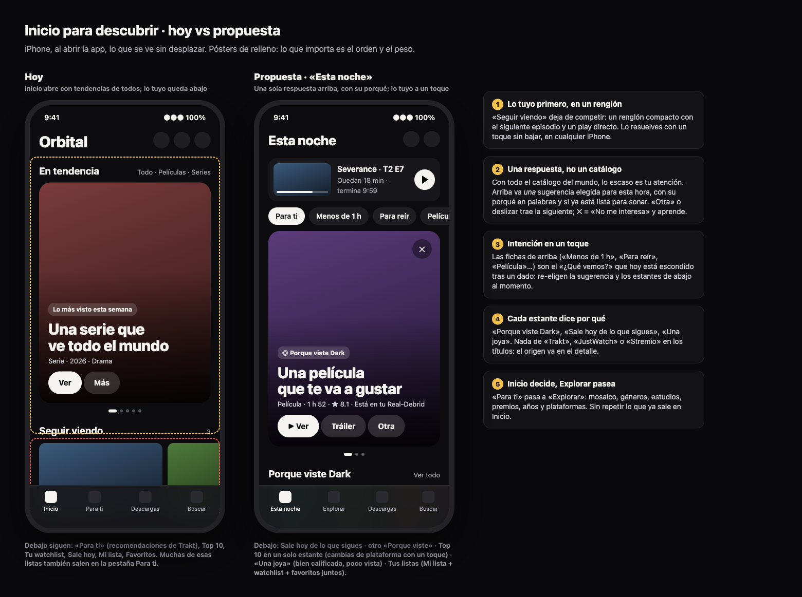

# Orbital · Análisis de UX, UI y técnico + Inicio para descubrir (28 oct 2026)

Revisión completa de las dos superficies (iPhone y TV) y de su código (Swift, Python y JS). Todo se leyó
en el código de `main` con los cambios locales de ese día; la TV se recorrió en la demo
(`scripts/demo_server.py`) con mando simulado. Maqueta del Inicio propuesto: `inicio-descubrir/maqueta.png`.

No repite lo que ya está en `diagnostico-2026-10.md`, `para-ti-iphone.md`, `barra-de-calidad-visual.md` ni
`busqueda-rapida.md`; cuando algo ya estaba planeado se dice.

---

## 1. Lo más importante en una página

1. **El reto no es tener catálogo, es elegir.** Orbital ya tiene todo el catálogo del mundo y unas 25 listas
   distintas. Lo que le falta es **ordenar por ti y explicar por qué**. Hoy las sugerencias se reparten
   «una de cada fuente por turno», sin puntaje: un Top 10 genérico de Paramount+ pesa lo mismo que tu
   recomendación personal, y lo ya visto no se quita del mosaico.
2. **Inicio del iPhone esconde lo tuyo.** Abre con un carrusel de tendencias de todos (~520 pt) y «Seguir
   viendo» queda abajo; en un SE, fuera de pantalla (`HomeView.swift:77-95`).
3. **Lo mismo sale dos y tres veces.** Recomendaciones de Trakt ×3, Top 10 ×2, estrenos ×2 (dos
   calendarios distintos), watchlist y Mi lista ×2, entre Inicio y Para ti.
4. **«¿Qué vemos?» es la mejor herramienta para decidir y está escondida** tras un dado sin texto.
5. **Técnica: la base es buena; lo que falta es dejar de hacer trabajo de más.** El reproductor vuelve a
   pintar toda su pantalla con cada avance del reloj; Para ti hace ~250 peticiones a TMDB al abrir en frío;
   el fondo grande de la TV se baja a tamaño original; la curaduría está escrita dos veces (Python y Swift)
   y ya no coincide.

---

## 2. UX y UI del iPhone

### 2.1 Mapa actual

Pestañas: **Inicio · Para ti · Descargas · Buscar** (`RootView.swift:190-198`).

| Quiero… | Camino hoy | Problema |
|---|---|---|
| Ver algo ya | Inicio → «Ver» en el carrusel | Lo que ofrece es tendencia general, no algo para ti |
| Seguir con lo que veía | Inicio → bajar → tarjeta | Hay que bajar primero |
| No sé qué ver | Para ti → dado → «¿Qué vemos?» | Ícono sin texto; en iPhone chico, dentro de un menú |
| Busco algo concreto | Buscar → escribir | Bien. No busca personas |
| Descargar para el avión | Ficha → Descargar → Descargas | Sirve; falta «toda la temporada» y ver el espacio antes |

### 2.2 Problemas de flujo

| # | Problema | Dónde |
|---|---|---|
| 1 | Carrusel de tendencias antes de «Seguir viendo» | `HomeView.swift:77` |
| 2 | El destacado de Para ti dice «El N.º 1 de cada plataforma», pero enseña tus recomendaciones de Trakt (prioridad 0) y luego las repite en el estante de abajo | `ParaTiView.swift:381`, `ParaTiModel.swift:212-219` |
| 3 | Duplicados entre pestañas: recs ×3, Top 10 ×2, estrenos ×2 (`ReleaseCalendarView` y `UpcomingView`), watchlist/Mi lista ×2 | `HomeView`, `ParaTiView:432-483` |
| 4 | Tres «por género» distintos (Cinemeta, TMDB, lista fija de ¿Qué vemos?) y cuatro fuentes de «lo popular» | `BrowseView:258`, `ParaTiView:643`, `DecideModel:145` |
| 5 | Cuatro maneras de guardar (Mi lista, watchlist, Favoritos, listas de Trakt) separadas por servicio, no por para qué | `ParaTiView:432-433` |
| 6 | «No me interesa», Guardar y Descargar solo con presión larga, sin pista visible | `ParaTiView:215`, `HomeView:391` |
| 7 | ¿Qué vemos? solo elige entre lo que Para ti ya cargó; dos nombres («Decide por mí» / «¿Qué vemos?») | `ParaTiView:111`, `DecideView:82` |
| 8 | Dos modos «sin pensar» (Mosaico y ¿Qué vemos?) para la misma tarea | — |
| 9 | «Más como esto» al fondo de la ficha, después de episodios y reparto | `TitleView.swift:610` |
| 10 | Jerga de servicios en pantalla: «JustWatch», «Stremio», «Trakt», «Real-Debrid aún no lo tiene» | `HomeView:450`, `ParaTiView:261`, `TitleView:660` |
| 11 | «Tus plataformas» es una lista fija, no las tuyas | `Charts.swift:42-48` |

### 2.3 Problemas de UI

- **Sin jerarquía:** Inicio tiene 9 secciones y Para ti ~15, casi todas con el mismo encabezado de dos líneas;
  6 carruseles seguidos se ven iguales (plataformas, estudios, temporadas, géneros, premios, años).
- **Barra de Para ti:** 4 íconos sin texto; dos casi idénticos (`list.bullet.rectangle` vs `list.bullet.indent`).
- **Contraste:** `textFaint` en texto que se lee («Guion», «Con», créditos, ayuda de ¿Qué vemos?). Va contra
  la decisión 3 de `propuesta-una-sola-experiencia.md`. Cambiar por `textMuted`.
- **VoiceOver:** los carruseles infinitos repiten las tarjetas ×40 (`Tokens.swift:418`); los puntos no dicen «3 de 10».
- **Toque chico:** «Borrar» en recientes, «más/menos» de la sinopsis.
- **Letra grande:** 24 `minimumScaleFactor` encogen texto en vez de partirlo.
- **Demasiadas formas de tarjeta** (deck, Still, Watchlist, RankedPoster, Wide, Cover, List, Fan, Collection, Year…).
- **Bien:** esqueletos y copia guardada al abrir, avisos sin conexión con acción, Reducir movimiento respetado.

---

## 3. UX y UI de la TV (con mando)

Capturas del recorrido: `/tmp/orbital-audit/tv/` (temporales, se pueden borrar).

| # | Problema | Impacto | Esfuerzo | Dónde |
|---|---|---|---|---|
| 1 | **El modo ambiente del mosaico entra a los 2 s** (el comentario dice 30 s). El primer botón solo lo despierta y el foco salta a otra pieza: pulsas Y sobre «Blade Runner» y acabas en otro título sin menú | Alto | Bajo | `foryou-mosaic.js:41` (`IDLE_MS = 2000`), `:368-379`, `:426` |
| 2 | **Cancelar un juego cuenta como jugado**: pasa a ser el destacado «Jugaste hace 2 min» mientras Para ti dice «Nunca lo has abierto» | Alto | Bajo | `sessions.py:170,193,225`; `main.js:1379` |
| 3 | El mosaico va de borde a borde: el foco llega a x≈3 px y se corta en TV con overscan | Alto | Bajo | `foryou-mosaic.css` |
| 4 | Películas y series: 12+ grupos, una fila visible; llegar a «Por año» son ~12 ↓; el pie no dice a qué grupo saltas | Medio | Medio | — |
| 5 | Juegos y video mezclados 3:2 sin intención; piezas «Al azar» sin arte | Medio | Medio | `foryou.py:1288-1297` |
| 6 | Inicio de la TV no tiene nada de descubrimiento | Alto | Medio | `core/home.js:131` |
| 7 | ¿Qué vemos? enseña puestos «2», «4» sin decir de qué; no muestra duración ni calificación aunque el servidor las manda | Medio | Bajo | `foryou.py:1513-1520` |
| 8 | «ORBITAL», «TRAKT» en encabezados; frase de Alexa en cursiva sobre el héroe | Medio | Bajo | — |
| 9 | Avisos apilados del mismo intento; la hoja «Tu consola» tapa el Inicio aunque ya haya 21 juegos | Medio | Bajo | — |
| 10 | Buscar: foco inicial en «1», resultados lejos del teclado | Medio | Medio | — |

Bien: foco claro y único, zona segura respetada fuera del mosaico, TV en vivo muy clara.

---

## 4. Técnico: más rápido, más ligero, mejor estructura

### 4.1 Imágenes: más rápido sin perder calidad

Lo que ya está bien: el iPhone reduce con ImageIO y guarda en memoria y disco; la consola sirve WebP del
tamaño pedido (`thumbs.py`, `remote_art.py`).

| Problema | Dónde | Arreglo |
|---|---|---|
| **TV:** el fondo grande y la precarga van a tamaño original (1920×1080 de metahub, hasta PNG 4K de Steam ≈ 8 MB de memoria cada uno) | `main.js:419,442-452`, `backdrop.js:103`, `api/library.py:137` | Pasar por `sized(url, innerWidth)`, añadir 1920 a `WIDTHS`, precargar con `img.decode()`, `fetchpriority="high"` en el héroe |
| **TV:** una imagen que no está en disco ocupa un hilo del servidor hasta 10 s; 40 a la vez traban menús y foco | `api/library.py:114-124`, `remote_art.py:36,80` | Si no está en disco: `307` a la original al momento y reducirla en segundo plano |
| **TV:** tarjetas sin `loading="lazy"` | `card.js:88` | `loading="lazy"` + `decoding="async"` fuera de vista |
| **iPhone:** cada póster se pide dos veces (small y medium) y se decodifican las dos, aunque la medium ya esté en disco | `Components.swift:204-213`, `Vocabulary.swift:114` | La versión ligera solo para fondos o si no hay nada en disco |
| **iPhone:** las «urgentes» se saltan el límite: ~96 decodificaciones a la vez en el mosaico, dentro del grupo de hilos de Swift | `ImagePipeline.swift:152,191,233` | Cola propia de 3–4 decodificaciones; urgentes primero, ninguna se salta el límite |
| **iPhone:** tamaños de más: TMDB `w500` para un póster de 112 pt (basta `w342`); `card = 200` pt para 168 pt reales | `Tmdb.swift:52`, `Tokens.swift:934,944` | Pedir por píxeles reales: `w342`/`w500`/`w780` |
| **iPhone:** reflejos con `.blur` + máscara + sombra en cada póster, cada cuadro (a 120 Hz) | `Collections.swift:428-470` | Generar el reflejo una vez en `ImagePipeline` y guardarlo en caché |
| **iPhone:** `LogoTrim` sin límite de memoria | `Components.swift:1025` | `NSCache` con costo |
| Fondo gris mientras carga | ambos | Guardar el color medio al decodificar y usarlo de fondo de espera (la TV ya lo calcula en el cliente: que lo mande el servidor) |
| Formato | — | En la red de casa, el iPhone pide las imágenes a la consola (WebP del tamaño exacto, 30–50 % más ligero); fuera, la original. AVIF no: cuesta CPU de la Legion Go |

**Resultado esperado:** la mitad de bytes y de decodificaciones por pantalla, sin bajar la nitidez (cada
imagen llega a los píxeles reales de su lugar en pantalla).

### 4.2 Velocidad y batería

| Problema | Dónde | Arreglo |
|---|---|---|
| **El reproductor repinta toda su pantalla con cada avance del reloj**, y rearma pistas y capítulos en cada «foto» del motor | `ObservableModel.swift:18-35`, `PlayerModel.swift:122`, `AetherEnginePlayer.swift:40,51,225-241` | Posición en un objeto `@Observable` aparte que solo lee la barra; pistas solo al cambiar; ≤ 4 actualizaciones/s |
| **Para ti repinta todo el feed** 2–3 veces por estante al cargar; el contenedor no es perezoso | `ParaTiModel.swift:33-50,183-200`, `ParaTiView.swift:370` | `changed()` solo si cambia; agrupar cambios; `featuredSlides` precalculado; luego `@Observable` por propiedad + `LazyVStack` |
| **~250 peticiones a TMDB al abrir en frío** (1 discover + 20 fichas por plataforma y tipo), caché solo en memoria, sesión `.ephemeral`, peticiones iguales duplicadas, y tocar la watchlist borra todo | `ForYou.swift:152-157,376-416`, `Net.swift:41`, `TitleModel.swift:385,406,464` | Caché permanente «TMDB→IMDb»; `remember` comparte la tarea en camino; borrar solo lo que cambió; caché HTTP en disco para TMDB |
| Arranque: Buscar se prepara con prioridad alta antes que Inicio; trabajo síncrono en `didFinishLaunching`; JSON grandes en `UserDefaults` | `RootView.swift:104-118`, `AppEnvironment.swift:836-850`, `Tmdb.swift:273-301` | Buscar después de la primera imagen de Inicio; lo de Siri y Centro de control en baja prioridad; blobs a archivos |
| **Servidor:** caché de Para ti sin límite, JSON completo reescrito en cada cambio (bloquea el GIL en la máquina que corre juegos) | `foryou.py:134-243` | SQLite con límite por tipo |
| **Servidor:** `lists()` espera a la red en frío | `foryou.py:535-603` | `stale=True` en todo y calentarlo en `warm()` |
| **Servidor:** JSON sin comprimir ni `ETag` hacia el iPhone por el túnel; el mosaico manda sinopsis de 96 piezas | `server.py`, `foryou.py:268-283` | `GZipMiddleware`, `ETag`, quitar `overview` del mosaico |
| **TV:** el mosaico anima `top/height/left/width/filter` bajo una máscara a pantalla completa | `foryou-mosaic.css:8,19`, `rail.css:7`, `home.css:74`, `shelf.css:47` | Solo `transform` y `opacity` (FLIP) |
| **TV:** ~30 `@import` CSS + 44 módulos con `no-cache` en cada arranque | `main.css:2-30`, `server.py:247-252` | Huella de versión + `immutable`; empaquetado mínimo |

### 4.3 Más ligera

- **AetherEngine (FFmpeg) ≈ 22 MB**: inevitable con ese motor; revisar si `dav1d` (AV1 por software) hace falta.
- **Extensión de widgets: 10 MB** porque arrastra todo OrbitalCore para usar solo `WidgetSnapshot`. Un
  objetivo pequeño `OrbitalShared` la aligera y aleja el límite de memoria de extensiones (~30 MB).

### 4.4 Estructura y arquitectura

1. **La curaduría está escrita dos veces y ya no coincide.** Mosaico, ¿Qué vemos? y «Hoy no» existen en
   Python (`foryou.py`, `decide.py`) y en Swift (`ForYou.swift`, `DecideModel.swift`), con tamaños, fuentes y
   reglas distintas. `/api/foryou/decide` no está en la app pública, así que el iPhone siempre calcula su
   versión (`Services.swift:56`: `forYouFromConsole = false`). Es también la causa de las 250 peticiones.
2. **Contrato del API sin esquema ni versión.** Respuestas `dict` sueltas que `RemoteForYou.swift` lee a
   mano. Precedente bueno a imitar: `design/tokens.json` y `vocabulario.json` con prueba de paridad.
3. **Archivos gigantes:** `main.js` (2 397 líneas, `state` global, 7 `setInterval`), `foryou.py` (1 598),
   `PlayerModel.swift` (1 597), `PlayerPanel.swift` (1 276), `Components.swift` (1 272).
4. **iPhone:** 58 usos de `AppEnvironment.shared` dentro de vistas (salta la inyección); la app compila en
   Swift 5 con los paquetes en Swift 6, así que nadie revisa 13 `Task.detached` ni el `@unchecked Sendable`
   del `ImagePipeline`; `WindowMetrics.size` usa `MainActor.assumeIsolated` (se cierra si lo lee el widget fuera del hilo principal).
5. **Bien:** OrbitalCore sin UIKit y con prueba de frontera; composición en un solo lugar; pruebas que
   comparan Python y Swift con los mismos casos.

### 4.5 Plan técnico por fases

**Rápido (1–3 días)**
1. TV: héroe y precarga reducidos; `/api/img` en frío con 307; `loading="lazy"`.
2. Servidor: gzip + `ETag` + mosaico sin sinopsis; `stale=True` en `lists()`; «Hoy no» en disco.
3. iPhone: una sola petición por póster; urgentes con límite; `w342`; `LogoTrim` en `NSCache`.
4. iPhone: `changed()` solo si cambia (Para ti y reproductor); pistas solo al cambiar; `remember` comparte tareas.
5. iPhone: arranque con Inicio primero.

**Medio (1–3 semanas)**
1. Posición del video en objeto aparte; reflejos cacheados; cola de decodificación con color de espera.
2. Caché permanente de TMDB y caché HTTP en disco.
3. Servidor: caché a SQLite; mosaico de la TV con `transform/opacity`; archivos con versión.
4. Contrato tipado (pydantic) + `contract/*.json` leído por las pruebas de Swift.
5. Partir `foryou.py` en `sources/`, `cache.py`, `curation.py`; partir `main.js` por pantalla.

**Estructural (semanas)**
1. **Servicio único de descubrimiento** (sección 5.4) que consumen la TV y el iPhone.
2. `@Observable` por propiedad, modelo por modelo; `LazyVStack` en los feeds.
3. Swift 6 estricto; objetivo `OrbitalShared` para widgets; `AppEnvironment` por `@Environment`.

Medir antes y después con las marcas `Perf` que ya existen (`paraTi.shelf`, `home.hero.image`, `ORBITAL-NET`) y `startup_profile.py`.

---

## 5. Inicio para descubrir

### 5.1 El reto, bien planteado

Cuando tienes acceso a todo, **lo escaso es la atención, no el contenido**. Netflix enseña ~40 títulos por
pantalla porque tiene que vender su catálogo; Orbital no vende nada. Su ventaja es poder decir **«esto,
ahora, por esto»** sin conflicto de intereses, y tenerlo **listo para sonar** (Real-Debrid).

Tres preguntas que se hace quien abre la app, en este orden, y el Inicio debe contestar en ese orden:

1. **¿Dónde me quedé?** → un renglón, un toque.
2. **¿Qué veo esta noche?** → una respuesta con su porqué, y una forma barata de decir «otra».
3. **¿Qué hay de nuevo que me importe?** → pocos estantes, cada uno con su razón.

Lo demás (géneros, estudios, premios, años, plataformas, mosaico) es **pasear**, y va en otra pestaña.

### 5.2 La propuesta: «Esta noche»

Pestañas: **Esta noche · Explorar · Descargas · Buscar** («Para ti» pasa a ser «Explorar»).

| Orden | Pieza | Qué hace | De dónde sale |
|---|---|---|---|
| 1 | **Seguir** (renglón compacto) | El siguiente episodio o lo que dejaste a medias, con ▶ directo y «termina 9:59». Si hay varios, desliza. Si se está viendo algo en la TV, aquí sale «Viendo en la TV» con controles | Stremio + estado de la consola |
| 2 | **Intención** (fichas) | Para ti · Menos de 1 h · Para reír · Película · Serie · Con alguien. Re-eligen la sugerencia y los estantes al momento. Es el «¿Qué vemos?» que hoy está escondido | Reglas de `decide` |
| 3 | **La sugerencia de esta noche** (una, grande) | Arte a sangre, porqué en palabras («Porque viste Dark», «Tu amiga la calificó con 9», «Sale hoy»), duración que cabe en tu hora, ★, y **«Ya está lista»** si Real-Debrid la tiene. Botones: ▶ Ver · Tráiler · Otra. ✕ = «No me interesa» y aprende. Tráiler sin sonido al quedarse quieto (respeta Reducir movimiento y datos bajos) | Servicio de descubrimiento |
| 4 | **Porque viste X** (1–2 estantes) | Uno por cada uno de los últimos títulos que terminaste | Trakt `related` |
| 5 | **Sale hoy de lo que sigues** | Solo si hay algo; si no, no se pinta | Calendario de Trakt |
| 6 | **Lo que todos ven** (un solo estante Top 10) | Número grande; cambias de plataforma con un toque; por defecto, **tus** plataformas | Netflix TSV + JustWatch |
| 7 | **Una joya** | Algo muy bien calificado y poco visto, fuera de tu zona habitual: la sorpresa (serendipia) | TMDB/Trakt con puntaje alto y popularidad baja |
| 8 | **Tus listas** | Mi lista + watchlist + Favoritos en un solo estante con filtro | Stremio + Trakt |

Reglas:
- **Nada se repite** entre Inicio y Explorar, ni dentro del Inicio (lo que sale en la sugerencia no sale abajo).
- **Cada estante dice por qué**, nunca de qué servicio. El servicio va en la ficha.
- **Lo visto no se sugiere.** Lo que se mostró 3 veces sin abrirse baja de peso.
- **Se adapta a la hora:** de noche, películas y episodios largos; a mediodía, cortos.
- **En la TV**, el mismo orden: el Inicio suma una fila «Esta noche» (sugerencia + 4 piezas con porqué)
  entre «Continuar» y «Tus consolas», y Para ti queda como Explorar (mosaico).

### 5.3 Qué gana y qué pierde Fernando

| | Gana | Pierde |
|---|---|---|
| **Esta noche** (recomendada) | Abrir la app y decidir en 1 toque. Una sola respuesta con su porqué. Lo tuyo nunca escondido. Inicio más corto y más rápido de cargar | El carrusel grande de tendencias como portada; se ve menos catálogo de golpe (pasa a Explorar) |
| Dejar Inicio como está y solo subir «Seguir viendo» | Cambio de una tarde | No resuelve el «no sé qué ver»: sigue siendo un catálogo de 9 listas |
| Mosaico como Inicio | Muy bonito, firma de la consola | Bueno para pasear, malo para decidir: no dice por qué ni cuánto dura |

**Recomendación:** «Esta noche». Es el único que contesta la pregunta del reto con una respuesta, no con
más opciones. Y se puede hacer en dos pasos sin tirar nada: primero reordenar con lo que ya existe;
después encender el puntaje del servidor.

### 5.4 El motor detrás: un solo servicio de descubrimiento

Hoy no hay puntaje: `_interleave` toma una de cada fuente por turno (`foryou.py:1311`), sin señales
propias. Propuesta (en la consola, una vez, para la TV y el iPhone):

1. **Candidatos:** los adaptadores de hoy (Trakt, Netflix TSV, JustWatch, TMDB, Stremio, juegos locales)
   llenan una tabla en SQLite en segundo plano. Ninguna petición espera a la red.
2. **Rasgos de cada candidato:** fuente, puesto en el chart, calificación, género, duración, año, estreno,
   si la sigues, si ya la viste, si Real-Debrid la tiene.
3. **Tus señales:** lo que reproduces en Orbital y en el iPhone, lo que abandonas a los 10 min, «No me
   interesa», «Hoy no», cuántas veces se mostró sin abrirse, la hora del día.
4. **Puntaje simple y explicable**, con pesos en `design/discovery.json` (compartido como `tokens.json`),
   luego **diversidad** (que no salgan tres thrillers seguidos) y un **porqué** por cada título.
5. **¿Qué vemos?** pasa a ser un filtro sobre la misma tabla (con las épocas y relajaciones que hoy solo tiene el iPhone).
6. **Registro** de qué se mostró y qué se abrió, para ajustar los pesos con datos reales.
7. Ruta: `/api/v1/discover?surface=tv|phone&section=tonight|because|joya|decide`, con `ETag`, también por el
   puerto público. `ForYou.swift` y `DecideModel` quedan solo como respaldo sin consola.

### 5.5 Orden de trabajo

| Paso | Qué | Esfuerzo |
|---|---|---|
| 1 | iPhone: «Seguir» arriba en renglón compacto; corregir la etiqueta del destacado; quitar duplicados entre pestañas | Bajo |
| 2 | iPhone: fichas de intención arriba (reusar `DecideModel`), sugerencia única con «Otra» y ✕ | Medio |
| 3 | TV: ambiente a 30 s y sin robar la pulsación; cancelar ≠ jugado; foco dentro de la zona segura | Bajo |
| 4 | Servidor: servicio de descubrimiento con puntaje, señales y porqué | Alto |
| 5 | iPhone y TV consumen `/api/v1/discover`; «Porque viste X» múltiple; «Una joya»; «Para ti» → «Explorar» | Medio |
| 6 | Tus plataformas elegibles en Ajustes; tráiler en la sugerencia | Medio |
