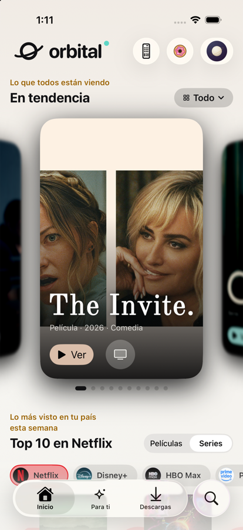
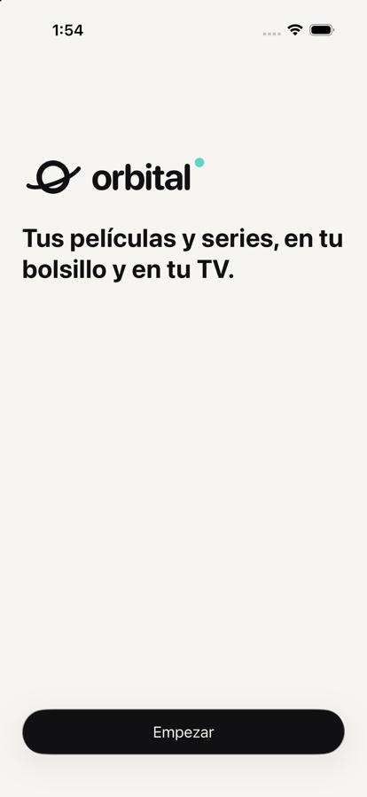
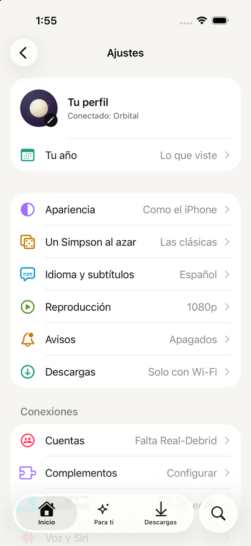

# Desacoplar Stremio · avance

Notas cortas de cada corte al terminar: qué quedó y qué falta. El plan está en
[`revision-plan.md`](revision-plan.md) y la propuesta en
[`../desacoplar-stremio-iphone-2026-10-29.md`](../desacoplar-stremio-iphone-2026-10-29.md).

## Corte A · iPhone (29 oct 2026)

**Quedó** (commit «iPhone, corte A: lo tuyo vive en el teléfono…»):

- `LocalLibrary` (`OrbitalCore/LocalLibrary.swift`, archivo `library.json`): dónde ibas (segundos exactos), lo visto por
  episodio y Mi lista viven en el teléfono. Inicio, la ficha, «¿Qué vemos?», Mi media, Colecciones, el widget y el
  vocabulario de Siri leen de ahí. Stremio ya no se lee para nada (solo se importa una vez).
- Se entra sin cuenta de Stremio (`RootView`). Stremio se conecta en Ajustes › Cuenta › «Stremio · respaldo» y recibe copia
  de todo (avance, visto, Mi lista, quitar de Seguir viendo); si falla, no se avisa y se reintenta.
- `LibrarySync`: al abrir, al volver a la app y al deslizar en Inicio sube lo de aquí y pregunta `/sync/last_activities`;
  solo baja lo que cambió: `/sync/playback` (lo que dejaste a medias en la TV ya sale en «Seguir viendo», el hueco de la
  prueba del 29 oct), `/sync/watched/*` + `/shows/{id}/progress/watched` de las 30 series más recientes, y la watchlist.
  La ficha de una serie pide además su `progress/watched` para los ✓.
- Fusión por título: gana lo más reciente (empate: el teléfono); lo visto se suma; lo que Trakt devuelve hasta 2 min después
  de que este teléfono le escribió es eco, no algo nuevo.
- Escribir en Trakt con las mismas reglas que la consola (`TraktProgressRule`, igual a `orbital/scrobble.py` `plan`): nunca
  < 1 %, como mucho 79.9 % hasta visto (90 % en películas, últimos 45–90 s en episodios, o créditos), ya visto al menos 80 %;
  respaldo cada 5 min (`start` + 2 s + `pause`); tras un respaldo, `start` antes de la pausa o el cierre; pausa al ir a
  segundo plano. Al retomar lo de otro aparato se regresan 10 s.
- Sin red: «Marcar como vista» (`POST /sync/history`), «no vista» (`/sync/history/remove`), «Quitar de Seguir viendo»
  (`DELETE /sync/playback/{id}`) y tu avance esperan en la cola; el avance viejo se descarta si Trakt ya tiene uno más nuevo.
- Mi lista = watchlist de Trakt: una sola lista fija en «Guardar» y en Inicio (el renglón «Mi lista» con las tarjetas de
  la watchlist). Sin Trakt se queda en el teléfono y sube al conectarlo.
- Pruebas: `LibrarySyncTests` (regla de %, respaldo, segundo plano, 85 %, fusión con empate, visto que se suma, watchlist con
  pendientes, avance viejo descartado, quitar, desmarcar que viaja, solo lo que cambió, importar de Stremio), `ResumeTests`,
  y las de Inicio y la ficha sin cuenta de Stremio. `swift test` completo en verde y la app compila con D y E ya en `main`.

Antes, con `-demo-signed-out` la app abría la pantalla «Entra con tu cuenta de Stremio»; ahora abre Inicio.

**Falta:**

- Probarlo con la cuenta real en el iPhone (aquí solo demo y clientes falsos): pausar en la TV y ver que salga en
  «Seguir viendo» del iPhone al volver a la app.
- Al conectar Trakt por primera vez, lo que solo estaba en el teléfono no se sube de golpe (sí lo que hagas después).
- Si otro aparato borra un avance a medias (sin terminarlo), el iPhone lo sigue enseñando hasta que lo quites o avances.
- Anime con ids de Kitsu: solo en el teléfono (Trakt no los conoce).
- «Marcar como no vista» existe en el modelo (`TitleModel.unmarkWatched`); falta ponerlo en el menú del episodio (corte C).
- Fase 2 (comparar Trakt contra Stremio y anotarlo en la bitácora): pendiente.

## Corte C · iPhone (29 oct 2026)

**Quedó:**

- La guía de la primera vez (`Screens/Onboarding/`, un archivo por tramo; modelo `OnboardingModel`): Bienvenida, Cómo
  funciona, Real-Debrid (qué es y precio), tu clave (abrir real-debrid.com/apitoken, «Pegar», comprobación al momento:
  incompleta, no reconocida o cuenta gratuita dicen qué hacer y «Continuar» se queda apagado), Complementos (los
  recomendados ya armados con tu clave, con interruptores), Trakt (código grande, se avanza solo al aprobar), «Conectado
  como…» con lo que se trajo, tu TV (con «Ahora no»; en la Mac no sale) y «Todo listo» con la invitación a Stremio aparte.
  Sale una sola vez (si ya tienes Real-Debrid y Trakt, no) y se reabre en Ajustes › «Cómo funciona Orbital».
  Demo: `-demo -demo-first-run`.
- Ajustes › **Cuentas**: Real-Debrid (usuario, Premium, días y vencimiento, «Renovar», «Cambiar clave», «Quitar»; los avisos
  a 14 y 3 días y el día que vence ya los programa el corte B), Trakt · principal, Stremio · respaldo (el único lugar con
  «Stremio» fuera de la última pantalla de la guía) y Tu Orbital.
- Ajustes › **Complementos**: en tu orden («Ordenar» y arrastrar), interruptor por complemento, qué aporta, «Importado»,
  deslizar para quitar; «Agregar»: los recomendados que falten, pegar dirección, volver a importar.
- El perfil dice solo lo que conectaste (Trakt · Real-Debrid · Orbital). El menú del episodio ya dice «Marcar como no
  visto» cuando está visto.
- Piezas nuevas al catálogo (`Design/Guide.swift`, tokens `DS.Guide`): `GuideSteps`, `GuidePage`, `GuidePiece`,
  `GuideNumberedStep`, `GuideCode`, `AddonLabel`. `ios_strings.py --check` en verde (también «sustos por delante»);
  `HomeView.swift` en 580 líneas.
- Pruebas: `OnboardingModelTests` (sale una vez, Real-Debrid no deja avanzar hasta Premium y arma los recomendados, solo la
  TV se salta, complementos ordenables y pegados, días en palabras). Paquete completo en verde y la app compila.

 

**Falta:**

- «Escanear QR» dentro de la app (para complementos y para la TV): hoy la TV se conecta con la cámara del iPhone, como antes.
- Comet y otros recomendados: la plantilla solo trae Torrentio y OpenSubtitles (corte B).
- Pruebas de interfaz `OnboardingUITests` en SE, mini y Pro Max: no se corrieron (solo capturas de la primera pantalla y de
  Ajustes en el simulador).
- Probarlo con tu cuenta real de Real-Debrid y Trakt en el iPhone.

## Corte D · iPhone (29 oct 2026)

**Quedó** (commits `def0a537` y el siguiente):

- Buscar › «Lo más popular hoy» y su lista completa salen de Trakt `trending` (películas y series alternadas, hasta 100):
  «Lo que más se está viendo ahora», con sello TRAKT. Si Trakt no contesta, la última copia guardada.
- «Por género»: `trending?genres=` y, si trae menos de 20, `popular?genres=` de los últimos 3 años, sin repetir.
- Búsqueda escrita: Trakt primero. Cinemeta solo si Trakt falla, no encuentra nada (Cinemeta perdona errores de dedo) o
  tarda más de 1.2 s. Si los dos fallan: «No pude buscar. Revisa tu conexión.»
- Para ti: el mosaico de respaldo y su relleno salen de Trakt `trending`; el aviso «Lo más popular en Stremio…» salió.
  El estante de respaldo en Listas es «En tendencia».
- «Listas de Stremio» → «De tus complementos» (Para ti › Listas y el índice de secciones). Sello «Complemento» con su token
  `DS.Collections.addon`; `DS.Collections.stremio` salió del catálogo. Lo que una consola manda como «Stremio» o «Cinemeta»
  se traduce («Complemento» o sin sello).
- Inicio › destacado: sin respaldo de Cinemeta; si Trakt no contesta, se queda el guardado.
- Textos: «Guardar en…» dice «Mi lista»; el aviso tras guardar ya no dice «· Stremio»; «No pude cambiar Mi lista»;
  «No encontré este título» en una persona sin IMDb; errores de catálogo sin «Stremio»; textos huérfanos fuera del catálogo.
- Demo: los catálogos de complemento dicen «Complemento», y hay una sección «Aprobadas por la crítica» (origen
  «Rotten Tomatoes», «92 % en Rotten Tomatoes» como porqué) para ver cómo la pinta el iPhone con `-demo-console`.
- Pruebas: `TraktPublicListsTests` (popular, copia guardada, género con relleno, búsqueda Trakt primero y respaldo) y
  `RemoteForYouTests.testListOriginsNeverSayStremio`.

- «Aprobadas por la crítica» (Rotten Tomatoes) en Para ti del iPhone, siempre, armada en el teléfono igual que en la
  consola: películas de la lista pública de MDBList `tbotcotw/recent-certified-fresh` y series de la lista pública de Trakt
  `truckclancy/rotten-tomatoes-certified-fresh-tv-shows-ranked-by-tomatometer-score`, sin clave ni sesión, un día en caché y
  la última copia si no contestan (`OrbitalCore/Critics.swift`, `CriticsTests`). Filtro Películas · Series, sello «Rotten
  Tomatoes» (token `DS.Collections.critics`) y porqué «Certified Fresh» / «Fresh en Rotten Tomatoes». Si la consola la
  manda (id `critics`), se pinta igual. Las listas por configuración de la consola (`para_ti.critics_*`) no se leen todavía.

**Falta o queda para otros cortes:**

- Cuenta (corte A): «Mi lista» de Inicio (va sin sello mientras siga saliendo de Stremio), el error del botón Guardar de la
  ficha («…tu lista de Stremio», `TitleModel.swift`), el aviso de sesión de Inicio, entrar. «Mi lista» ya no está como
  tarjeta en Para ti › Listas: «Tu watchlist» de Trakt ocupa ese lugar.
- Ajustes (corte C): «Stremio conectado», el perfil «Stremio · Trakt · Orbital».
- Sin capturas de antes y después: el simulador está ocupado por otras sesiones. Se comprueba en Buscar (el carrusel dice
  «Lo que más se está viendo ahora» con sello TRAKT) y en Para ti › Listas («De tus complementos»).
- Ya venía de `main`: `HomeView.swift` tiene 603 líneas (tope 600, `FileBudgetTests`) y `ios_strings.py --check` pide
  «%@ sustos por delante» (en `PlayerScreen+Panel.swift` el número va con `Text(verbatim:)` o como `%lld`).

## Corte B · iPhone (29 oct 2026)

**Quedó** (lógica, pruebas y demo; la interfaz de Ajustes y la guía son del corte C):

- Módulo nuevo `ios/OrbitalCore/Sources/OrbitalAddons` (solo Foundation: no conoce a Stremio ni a Trakt), con sus pruebas
  `OrbitalAddonsTests`:
  - `AddonList`: tus complementos en el teléfono, en tu orden (`move(fromOffsets:toOffset:)`, como `.onMove`), con
    interruptor, agregar recomendado o pegado, quitar, opciones. Lo no secreto en los ajustes; la URL de uno pegado o
    importado en el llavero (`AddonKeys.addonURL(id)`). `isConfigured` dice si ya manda la lista del teléfono.
  - `AddonCatalog`: los recomendados como plantilla (Torrentio con `realdebrid={CLAVE}`, calidades y idiomas; OpenSubtitles).
    La URL se arma al vuelo con la clave: cambiarla cambia todos a la vez. `AddonRedaction` tapa la clave en textos.
  - `importOnce`: trae una vez tus complementos de Stremio y los que pegaste (sin Cinemeta); no escribe de vuelta.
  - `RealDebrid` (`DebridProvider`): solo `GET /rest/1.0/user`. `DebridStatus`: usuario, Premium, días que quedan,
    vencimiento y estado (activo, por vencer a 14 días, vencido, gratuito). Errores claros: clave incompleta, no
    reconocida, sin red. `DebridAccount`: la clave en el llavero (`realdebrid_token`), comprobar sin guardar, guardar,
    quitar; el estado se guarda un día y, si no contesta, queda el último.
  - `DebridReminders` / `DebridReminderBook`: avisos a 14 días, a 3 días y el día que vence, a las 10:00, una sola vez por
    fecha de vencimiento (si renuevas, tocan los de la nueva).
- `OrbitalCore`: `AddonRegistry` usa la lista del teléfono cuando está armada (en tu orden, sin los apagados, y la cuenta de
  Stremio ni se pregunta); sin ella, como antes. `AppAddonVault` (llavero + ajustes), `RealDebrid(http:)` por la red de la
  app, `StremioImport`. Pruebas `LocalAddonsTests`.
- `Services`: `addonList`, `debrid`, `debridReminders` e `importAddonsFromStremio(again:)`.
- App: al abrir se refresca el estado y se programan los avisos que falten (`Platform/DebridReminderNotifier.swift`, sin
  pedir permiso: eso lo hace Ajustes). Al tocar «Ver» sin fuentes y con Real-Debrid vencido: «Tu Real-Debrid venció hace
  N días · Renovar» en vez de «Real-Debrid aún no lo tiene». La leyenda «Al instante» de las fuentes se esconde si ya
  armaste tu lista y no hay clave.
- Demo: `-demo-rd premium|soon|expired|free|invalid` pone una clave de mentira y finge `api.real-debrid.com`. Además, la
  demo finge lo público de Trakt (tendencia, popular, búsqueda, la lista de la crítica) y MDBList.

**Para el corte C** (lo que tiene que llamar la interfaz):

- Guía, paso Real-Debrid: `try await services.debrid.verify(clave)` → `DebridStatus` o `DebridError` (su `description`
  ya está en español e inglés); luego `services.debrid.save(token:status:)`. Enlaces: `services.debrid.provider.tokenURL`
  y `renewURL`.
- Guía, paso Complementos: `services.addonList.startWithRecommended()` (o `add(_:)` por cada interruptor) y
  `await services.resetAccountCaches()`; `AddonCatalog.recommended` trae nombre, `summary`, `usesDebrid` y `onByDefault`.
- Ajustes › Complementos: `installed`, `setEnabled`, `move`, `remove`, `add(url:name:resources:)` (con
  `Addons.manifestURL` y `Addons.parseManifest` para leer el nombre) y «Importar de Stremio»
  (`services.importAddonsFromStremio()`). Después de cada cambio, `resetAccountCaches()`.
- Ajustes › Real-Debrid: `await services.debrid.status(force: true)`, `state(now:)`, `daysLeft(now:)`, `remove()`.
- Pedir permiso de avisos al guardar la clave y llamar a `DebridReminderNotifier.refresh(services)`.

**Falta:**

- Comet y otros recomendados (su configuración va cifrada en la URL; mejor probarla con una cuenta real antes).
- Tocar el aviso de vencimiento abre la app, no la página de renovar.
- Sin capturas: todo es lógica sin pantalla nueva; se comprueba con `swift test` (`OrbitalAddonsTests`, `LocalAddonsTests`).

## Corte E · Consola (29 oct 2026, sesión en la nube)

**Quedó** (commit `dc8b330`):

- `orbital/trakt_sync.py`: la consola une su biblioteca de Stremio con lo de Trakt. Seguir viendo trae lo que tienes a
  medias en Trakt (`/sync/playback`) y el episodio que sigue de tus últimas 15 series (`/shows/{imdb}/progress/watched`);
  gana lo más reciente por título. Una película vista o una serie al día en otro aparato sale de la fila.
- Solo baja lo que cambió: pregunta `/sync/last_activities` al abrir Inicio (a lo más cada minuto), al arrancar y cada vez
  que la consola guarda algo en Trakt.
- Mi lista = tu watchlist de Trakt (ordenada por cuándo la guardaste); Guardar escribe en Trakt y deja copia en Stremio.
  «Quitar de Seguir viendo» borra el avance en Trakt y la consola recuerda la hora para no regresarlo con datos viejos.
- Ficha: los ✓ por episodio suman Stremio y Trakt; «Continuar» va a lo más reciente de los dos.
- Escribir como el iPhone (`orbital/scrobble.py` `plan`): respaldo cada 5 min (`start` y 2 s después `pause`), tope de
  79.9 % hasta que se da por visto (90 %, el final del episodio o los créditos), nunca una pausa bajo el 1 %; al terminar
  antes del 80 % se cierra en 80 % para que Trakt lo marque visto.
- Para ti de la consola ya no manda «Stremio» como origen (Trakt, Cinemeta o Complemento); con Trakt, Mi lista es «Tu
  watchlist».
- La voz («sigue viendo», «continúa X») encuentra lo que viste en el iPhone: los títulos de Trakt entran al mismo índice.
- Pruebas: `tests/test_trakt_sync.py` (fusión, lo que cambió, reglas de escritura, la consola completa con un Trakt falso).

**Rotten Tomatoes** (commit `f1c1da8`): Para ti › «Aprobadas por la crítica» (id `critics`): películas Certified Fresh de
los últimos 90 días (lista pública de MDBList `tbotcotw/recent-certified-fresh`) y series Certified Fresh (lista pública de
Trakt de truckclancy). Un día en caché. Sin clave sale igual; con la clave de MDBList (Ajustes › Cuentas › MDBList) va por
su API. Las listas se cambian en `config.yaml` (`para_ti.critics_movies`, `critics_series`). Pruebas: `tests/test_mdblist.py`.

**Falta:**

- Probarlo en la Lenovo con la cuenta real (aquí no hay red a Trakt ni a MDBList): abrir en el iPhone una película, pausarla
  y ver que salga en Seguir viendo de la TV en menos de un minuto al volver a Inicio.
- Confirmar que la lista pública de MDBList contesta en `/json` sin clave; si no, poner la clave en Ajustes.
- No hay sondeo aparte: si la TV está en Inicio sin tocarla, se entera al siguiente cambio de pantalla.
- Quitar de Seguir viendo una serie al día solo se recuerda en la consola (Trakt no tiene «ocultar de la fila» por
  título sin usar `/users/hidden`).
